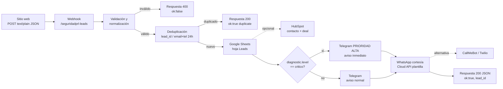

# Automatizaciones de leads · SEGURIDAD PRL

Esta carpeta junta todo lo necesario para que cada consulta del sitio web (formulario de contacto, landing y diagnóstico de riesgo) llegue **en segundos** al equipo comercial, quede registrada en un CRM liviano y el prospecto reciba un mensaje de cortesía.

```
automatizaciones/
├── README.md                          ← este documento
├── payload.schema.json                ← contrato JSON (draft 2020-12)
├── ejemplos/                          ← payloads de prueba
│   ├── lead-contacto.json
│   ├── lead-landing.json
│   └── lead-diagnostico-critico.json
├── n8n/workflow-leads-seguridadprl.json   ← workflow importable (opción principal)
├── google-apps-script/Code.gs         ← alternativa 100 % gratuita sin n8n
├── google-sheets/estructura-crm.md    ← estructura del CRM en Sheets
└── mensajes/plantillas-mensajes.md    ← textos de Telegram, WhatsApp y email
```

---

## 1. Flujo general



### Contrato del payload

El front envía un `POST` con `Content-Type: text/plain;charset=utf-8` (para evitar el *preflight* CORS). **El body es un string JSON** que el receptor debe parsear. La especificación formal está en [`payload.schema.json`](payload.schema.json) y hay ejemplos en [`ejemplos/`](ejemplos/).

| Evento | `meta.source` | ¿`diagnostic`? |
|---|---|---|
| `lead.contacto` | `sitio-web` | `null` |
| `lead.landing` | `landing` | `null` |
| `lead.diagnostico` | `diagnostico` | objeto con `score`, `level`, `answers`, etc. |

---

## 2. Implementación en n8n (opción principal)

> Archivo listo para importar: [`n8n/workflow-leads-seguridadprl.json`](n8n/workflow-leads-seguridadprl.json). En n8n: **Workflows → Import from File**.

Pasos lógicos (los nodos del JSON siguen este orden):

1. **Webhook** — método `POST`, path `seguridadprl-leads`, *Respond*: `Using 'Respond to Webhook' Node`. URL de producción: `https://TU-N8N/webhook/seguridadprl-leads`.
2. **Code · Validar y normalizar** —
   - Parsea `body` si llega como string (text/plain) o lo usa directo si ya es objeto.
   - Verifica el *secret* (`?key=` en la URL, ver §6).
   - Valida campos mínimos: `meta.lead_id`, `contact.nombre`, y al menos `email` o `telefono`; `consent.privacy_accepted === true`.
   - Normaliza teléfono a **E.164 Argentina** (`+549` + código de área + número, sin el `0` ni el `15`).
   - Arma los textos de Telegram (normal/crítico) y los parámetros de la plantilla de WhatsApp.
3. **IF · ¿Válido?** — si `valid` es falso → **Respond 400**.
4. **Google Sheets · Append** — hoja `Leads` del documento CRM (ver [`estructura-crm.md`](google-sheets/estructura-crm.md)). Para deduplicar, activá en el nodo la opción *Append or Update* usando `lead_id` como columna de coincidencia (si el front reenvía el mismo lead, se actualiza en vez de duplicar).
5. **(Opcional) HubSpot** — agregá un nodo *HubSpot → Contact: Create or Update* por email, y *Deal: Create* con el `lead_id` en el nombre del negocio. Va en paralelo a Sheets.
6. **IF · ¿Nivel crítico?** — `diagnostic.level == "critico"`.
7. **Telegram** — dos nodos `sendMessage` con `parse_mode: HTML`: uno con el texto de **prioridad alta** (rama crítica) y otro normal.
8. **IF · ¿Acepta WhatsApp?** — `consent.contact_whatsapp === true` y teléfono válido.
9. **HTTP Request · WhatsApp Cloud API** — `POST https://graph.facebook.com/v20.0/{{PHONE_NUMBER_ID}}/messages` con la plantilla `seguridadprl_confirmacion_consulta`. Configurá *Continue On Fail* para que un error de Meta no bloquee la respuesta al front.
10. **Respond to Webhook** — `200` con `{"ok": true, "lead_id": "..."}`.

**Variables/credenciales a reemplazar en n8n:**

| Placeholder | Dónde |
|---|---|
| `TU_WEBHOOK_SECRET` | Code node (constante `SECRET`) |
| `TU_GOOGLE_SHEET_ID` | Nodo Google Sheets (documentId) |
| `TU_CREDENCIAL_GOOGLE` | Credencial OAuth2 de Google Sheets |
| `TU_CREDENCIAL_TELEGRAM` | Credencial Telegram (bot token) |
| `TU_CHAT_ID` | Nodos Telegram (chatId) |
| `TU_PHONE_NUMBER_ID` | URL del HTTP Request |
| `TU_WHATSAPP_TOKEN` | Header `Authorization: Bearer ...` (idealmente como credencial *Header Auth*) |

> [!TIP]
> En n8n self-hosted podés usar variables de entorno (`$env.WA_TOKEN`) en lugar de escribir el token en el nodo.

---

## 3. Implementación en Make (alternativa)

1. **Webhooks → Custom webhook**. Copiá la URL. Como el body llega como `text/plain`, activá *JSON pass-through* o agregá el módulo siguiente.
2. **JSON → Parse JSON** sobre el body crudo, usando como estructura el ejemplo [`lead-diagnostico-critico.json`](ejemplos/lead-diagnostico-critico.json) (*Generate data structure*).
3. **Filtro** entre módulos: `contact.nombre` existe **y** (`email` existe **o** `telefono` existe) **y** `consent.privacy_accepted = true` **y** el query `key` = `TU_WEBHOOK_SECRET`.
4. **Tools → Set variable** `telefono_e164` con: `replace(replace(contact.telefono; /[^\d+]/g; ""); /^0/; "+54")` (o normalizá en el front, que ya envía `+549...`).
5. **Google Sheets → Search Rows** por `lead_id` (deduplicación) → **Filtro** “Total number of bundles = 0” → **Google Sheets → Add a Row** en `Leads`.
6. *(Opcional)* **HubSpot CRM → Create/Update a Contact**.
7. **Router** con 2 rutas:
   - Ruta A, filtro `diagnostic.level = critico` → **Telegram Bot → Send a Text Message** (texto crítico, *Parse mode* HTML).
   - Ruta B, *fallback* → **Telegram Bot → Send a Text Message** (texto normal).
8. **HTTP → Make a request** a WhatsApp Cloud API (mismo body que en n8n) si `consent.contact_whatsapp = true`. Configurá *error handler* → **Ignore**.
9. **Webhooks → Webhook response**: status `200`, body `{"ok":true,"lead_id":"{{meta.lead_id}}"}`.

---

## 4. Telegram: token y chat_id

1. En Telegram, abrí **@BotFather** → `/newbot` → nombre (`SEGURIDAD PRL Leads`) y usuario (`seguridadprl_leads_bot`). Te devuelve el **token** (`123456789:AA...`) → es tu `TU_BOT_TOKEN`.
2. Creá un **grupo** “Comercial SEGURIDAD PRL”, agregá el bot y mandá cualquier mensaje (por ejemplo `/start`).
3. Abrí en el navegador `https://api.telegram.org/botTU_BOT_TOKEN/getUpdates` y buscá `"chat":{"id":-100XXXXXXXXXX ...}`. Ese número (negativo para grupos) es tu `TU_CHAT_ID`.
4. Opcional: en @BotFather → `/setprivacy` → *Disable* si querés que el bot lea mensajes del grupo (no es necesario solo para enviar).
5. Prueba rápida:
   ```bash
   curl -s "https://api.telegram.org/botTU_BOT_TOKEN/sendMessage" -d chat_id=TU_CHAT_ID -d text="Prueba OK"
   ```

---

## 5. WhatsApp Cloud API (Meta)

### Alta
1. Creá una app en [developers.facebook.com](https://developers.facebook.com) → tipo *Business* → agregá el producto **WhatsApp**.
2. Asociá una cuenta de **WhatsApp Business** (WABA) y registrá el número `+54 9 XXX XXX XXXX` (no puede estar en uso en la app de WhatsApp común).
3. Anotá el **Phone Number ID** (`TU_PHONE_NUMBER_ID`).
4. Generá un **token permanente** con un *System User* en Business Manager (permisos `whatsapp_business_messaging` y `whatsapp_business_management`) → `TU_WHATSAPP_TOKEN`.

### Plantilla (obligatoria para iniciar conversación)
En **WhatsApp Manager → Plantillas de mensajes → Crear**:

- **Nombre:** `seguridadprl_confirmacion_consulta`
- **Categoría:** `UTILITY` (confirmación de una solicitud iniciada por el usuario)
- **Idioma:** Español (Argentina) — `es_AR`
- **Cuerpo:**

```text
Hola {{1}}, gracias por contactar a SEGURIDAD PRL. Recibimos tu consulta en nombre de {{2}} y un profesional de Higiene y Seguridad se va a comunicar con vos dentro de las próximas 24 horas hábiles. Si preferís, podés responder este mensaje con el mejor horario para hablar.
```

- **Ejemplos de variables:** `{{1}}` = `Juan`, `{{2}}` = `Servicios Patagónicos S.A.`
- **Pie (opcional):** `SEGURIDAD PRL · Prevención de Riesgos Laborales`

La aprobación suele tardar de minutos a 24 h. Body de envío:

```json
{
  "messaging_product": "whatsapp",
  "to": "5492974000000",
  "type": "template",
  "template": {
    "name": "seguridadprl_confirmacion_consulta",
    "language": { "code": "es_AR" },
    "components": [
      { "type": "body", "parameters": [
        { "type": "text", "text": "Juan" },
        { "type": "text", "text": "Servicios Patagónicos S.A." }
      ]}
    ]
  }
}
```

> [!NOTE]
> El campo `to` va **sin el `+`**. Para Argentina usá el formato `549` + área + número.

### Alternativas
- **CallMeBot** (gratis, solo para avisos internos al propio equipo, no a prospectos): `https://api.callmebot.com/whatsapp.php?phone=549XXXXXXXXXX&text=...&apikey=TU_APIKEY`.
- **Twilio WhatsApp**: `POST https://api.twilio.com/2010-04-01/Accounts/TU_ACCOUNT_SID/Messages.json` con `From=whatsapp:+14155238886`, `To=whatsapp:+549...` y `ContentSid` de la plantilla aprobada.

---

## 6. Seguridad y cumplimiento

- **Secret compartido:** agregá `?key=TU_WEBHOOK_SECRET` a la URL del webhook (el front usa `text/plain` sin headers custom para evitar preflight, por eso se usa query en vez de header). El Code node / Apps Script rechaza requests sin el secret. Si usás un proxy propio, preferí el header `X-PRL-Secret`.
  > El secret en una URL pública del front **no es secreto absoluto**: sirve para frenar bots genéricos. La defensa real es validar, limitar y no exponer credenciales.
- **Nunca** pongas tokens de Telegram, WhatsApp, HubSpot o Google en el front (`config.js`). Solo va la URL del webhook.
- **Rate limiting:** en n8n self-hosted, poné delante un reverse proxy (Nginx `limit_req zone=leads rate=5r/m`) o Cloudflare (regla de *Rate limiting* sobre `/webhook/seguridadprl-leads`). En Apps Script, el código incluye un limitador simple por email/teléfono usando `CacheService`.
- **Validación estricta:** largo máximo de campos, escape de HTML antes de mandar a Telegram (`parse_mode HTML`), y descarte de payloads sin `consent.privacy_accepted`.
- **Honeypot:** el front ya filtra `website`; igual el backend descarta si llega ese campo con contenido.
- **Ley 25.326 (Protección de Datos Personales):**
  - Recolectar solo los datos necesarios y con **consentimiento expreso** (checkbox `privacy_accepted`), informando finalidad, destinatarios y derechos de acceso, rectificación y supresión.
  - Publicar la política de privacidad en el sitio e indicar el responsable de la base de datos.
  - Evaluar la **inscripción de la base** en el Registro Nacional de Bases de Datos (AAIP).
  - Restringir el acceso a la planilla/CRM solo al equipo comercial; activar 2FA en Google/Meta/Telegram.
  - Definir un plazo de conservación (por ejemplo, borrar leads *Perdidos* luego de 24 meses).
  - Solo enviar WhatsApp si `consent.contact_whatsapp === true`.

---

## 7. Conectar el front

En `sitio/assets/js/config.js` completar:

```js
webhookUrl: 'https://TU-N8N/webhook/seguridadprl-leads?key=TU_WEBHOOK_SECRET',
// o, si usás Apps Script:
// webhookUrl: 'https://script.google.com/macros/s/TU_DEPLOYMENT_ID/exec?key=TU_WEBHOOK_SECRET',
```

Probar desde la terminal con un ejemplo:

```bash
curl -X POST "https://TU-N8N/webhook/seguridadprl-leads?key=TU_WEBHOOK_SECRET" \
  -H "Content-Type: text/plain;charset=utf-8" \
  --data-binary @ejemplos/lead-diagnostico-critico.json
```

Respuesta esperada: `{"ok":true,"lead_id":"PRL-20261004-CR77"}`.

> [!IMPORTANT]
> Apps Script responde con una redirección 302 a `script.googleusercontent.com`; `fetch` la sigue automáticamente. Con `curl` agregá `-L`.

---

## 8. Checklist de puesta en marcha

- [ ] Crear la planilla CRM con la hoja `Leads` (o correr `setup()` de Apps Script).
- [ ] Crear bot de Telegram y obtener `chat_id`.
- [ ] Alta de WhatsApp Cloud API y aprobación de la plantilla.
- [ ] Importar el workflow n8n, reemplazar placeholders y **activarlo**.
- [ ] Completar `webhookUrl` en `config.js`.
- [ ] Enviar los 3 ejemplos y verificar Sheets + Telegram + WhatsApp.
- [ ] Publicar política de privacidad (Ley 25.326).
