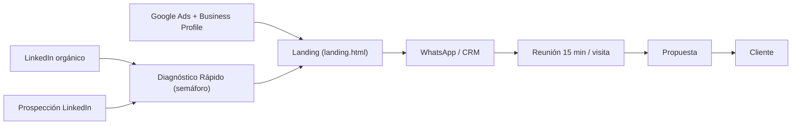

# Estrategia de Captación — SEGURIDAD PRL

> Objetivo: convertir visibilidad técnica en reuniones calificadas, con el **Diagnóstico Rápido de Cumplimiento Normativo** como puerta de entrada.

## 1. Embudo completo

| Etapa | Qué pasa | Responsable / herramienta | Tiempo de respuesta |
|---|---|---|---|
| Atracción | Posts (4 pilares), prospección, Ads, Google Maps | Consultor referente + página empresa | — |
| Captura | Diagnóstico completado → nombre, empresa, rubro, ciudad, WhatsApp/email | Herramienta + landing | Automático |
| Calificación | Lead con color: 🔴 Crítico (prioridad 1), 🟡 Medio (2), 🟢 Bajo (nutrir) | CRM [COMPLETAR: HubSpot free / Pipedrive / planilla] | Crítico < 4 h · Medio < 24 h |
| Contacto | WhatsApp con resultado personalizado (ver `secuencia-prospeccion.md`) | Consultor | Mismo día |
| Reunión | 15 min: contexto, actividad, normativa que aplica, urgencia (obra, ingreso a operadora, inspección) | Consultor de la especialidad | Agendada en < 72 h |
| Propuesta | Alcance cerrado por servicio (de los 12) | Equipo | < 48 h post-reunión |
| Seguimiento | Llamada a los 3 días; si no avanza, nutrir con contenido | CRM | — |
| Postventa | Pedir recomendación en LinkedIn/Google + venta cruzada (estadística mensual, capacitación, auditoría) | Consultor | 30 días post-entrega |

**Etapas del CRM:** Nuevo → Contactado → Reunión agendada → Reunión hecha → Propuesta enviada → Ganado / Perdido (con motivo).

## 2. Google Ads de búsqueda local

**Por qué:** capta la demanda que *ya está buscando* (obra que arranca, habilitación pendiente, ingreso como contratista). Complementa LinkedIn, que genera demanda.

**Estructura recomendada:**
- Campañas por zona: **Neuquén/Añelo**, **Comodoro Rivadavia/Santa Cruz**, **Coronel Rosales/Bahía Blanca**. Segmentación por radio + "presencia" (personas *en* la zona, no "interesadas en").
- Grupos de anuncios por intención: Programa de seguridad / Habilitación municipal / Servicio externo de HyS / Capacitaciones / Auditoría e ISO 45001.
- Concordancia de frase y exacta al inicio; amplia solo con lista de negativas sólida.
- Presupuesto inicial: [COMPLETAR: monto diario por zona]. Revisar términos de búsqueda 2 veces por semana el primer mes.
- Conversiones: envío de formulario, clic a WhatsApp, diagnóstico completado, llamada desde anuncio.

**Palabras clave ejemplo:**
| Grupo | Keywords |
|---|---|
| Programa de seguridad | "programa de seguridad obra Neuquén", "programa de seguridad decreto 911", "programa de seguridad construcción Comodoro", "aviso de obra y programa de seguridad" |
| Habilitación | "habilitación municipal informe seguridad Comodoro", "informe de higiene y seguridad para habilitación Neuquén", "certificado de seguridad para habilitación comercial" |
| Servicio externo | "servicio de higiene y seguridad Añelo", "técnico en higiene y seguridad externo Neuquén", "consultora higiene y seguridad Comodoro Rivadavia", "higiene y seguridad Caleta Olivia", "higiene y seguridad Punta Alta" |
| Contratistas O&G | "documentación de seguridad para contratistas petroleros", "asesoramiento HSE contratista Vaca Muerta" |
| Capacitación | "capacitación trabajo en altura Neuquén", "capacitación espacios confinados", "curso de seguridad in company Comodoro" |
| Auditoría / gestión | "auditoría de higiene y seguridad", "implementación ISO 45001 Neuquén", "investigación de accidentes laborales" |

**Palabras clave negativas:** curso gratis, gratis, pdf, descargar, apuntes, tesis, monografía, carrera, tecnicatura, licenciatura, universidad, facultad, inscripción, empleo, trabajo de, busco trabajo, sueldo, salario, CV, pasantía, modelo, plantilla, ejemplo, wikipedia, qué es, definición, seguridad privada, vigilador, alarmas, cámaras de seguridad, seguridad informática, ciberseguridad, cerrajería, matafuegos venta (si no se ofrece).

**Anuncio ejemplo (RSA):**
- Títulos: `Higiene y Seguridad en Neuquén` · `Programa de Seguridad para tu Obra` · `+20 Años en Oil & Gas y Obras` · `Diagnóstico de Cumplimiento Gratis` · `Seguridad que Brinda Soluciones`
- Descripciones: `Programas de seguridad, ATS, auditorías y capacitaciones. Profesionales que vienen del campo.` · `Hacé el diagnóstico gratis en 5 min y recibí tu semáforo de cumplimiento. Respuesta en el día.`
- Extensiones: llamada, WhatsApp, ubicación (GBP), enlaces a servicios clave.

## 3. Google Business Profile por ciudad

- **Un perfil por ciudad con dirección o área de servicio real** (Comodoro Rivadavia, Neuquén/Añelo, Santa Cruz [COMPLETAR: localidad], Coronel Rosales). No crear perfiles con direcciones ficticias: Google los suspende. Si no hay oficina, usar perfil de **área de servicio** (sin dirección visible).
- Categoría principal: "Consultor en seguridad laboral" / "Servicio de seguridad e higiene" [VERIFICAR categoría disponible]; secundarias: "Consultor ambiental", "Centro de formación".
- Nombre: `SEGURIDAD PRL` (sin relleno de keywords). Descripción con servicios y zona.
- Cargar los 12 servicios con descripción, fotos reales de campo/capacitaciones (mensual), horario, WhatsApp, link a landing con UTM `utm_source=gbp&utm_medium=[ciudad]`.
- Publicaciones semanales: reutilizar los posts de LinkedIn (versión corta).
- Reseñas: pedirlas a cada cliente al cerrar un servicio (link directo); responder todas. Nunca reseñas falsas.
- Preguntas y respuestas precargadas: "¿Hacen informes para habilitación municipal?", "¿Atienden en Añelo?", etc.

## 4. Métricas del embudo

| Etapa | Métrica | Fórmula | Meta inicial |
|---|---|---|---|
| Atracción | Impresiones / alcance (LI, Ads, GBP) | — | [COMPLETAR] |
| Atracción → Captura | CTR al diagnóstico/landing | clics / impresiones | Ads ≥ 5 % [referencia de mercado, VERIFICAR] |
| Captura | Tasa de completado del diagnóstico | completados / iniciados | ≥ 60 % |
| Captura | Leads por fuente | por UTM | — |
| Calificación | % leads Crítico + Medio | — | — |
| Contacto | Tiempo a primer contacto | promedio horas | < 24 h |
| Reunión | Lead → reunión | reuniones / leads | [COMPLETAR] |
| Propuesta | Reunión → propuesta | propuestas / reuniones | [COMPLETAR] |
| Cierre | Propuesta → cliente | ganados / propuestas | [COMPLETAR] |
| Económicas | Costo por lead (Ads), costo por reunión, ticket promedio, CAC | — | [COMPLETAR tras 30 días] |

**Rutina de revisión:** semanal (leads, contacto, reuniones) y mensual (conversiones por etapa y por canal, CAC, ajuste de presupuesto y contenidos). Las metas se fijan con datos reales del primer mes; no usar benchmarks sin validar.
